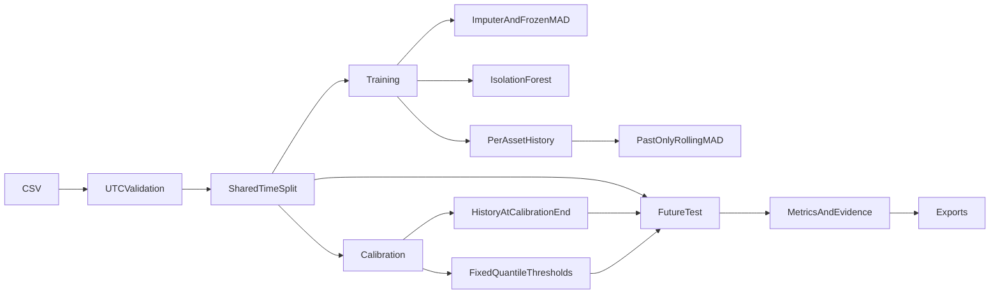

# Architecture — audited protocol v2

Local CPU only: CSV -> strict UTC/schema validation -> shared chronological periods -> training-only preprocessing -> frozen MAD / past-only rolling MAD / Isolation Forest -> calibration-only thresholds -> future held-out scores, evidence, CSV/JSON and charts.

## Time and preprocessing boundaries

`shared-utc-60-20-20-v2` divides the sorted distinct UTC timestamps at floor(0.6*n) and floor(0.8*n). All assets share these cutoffs; ratios count unique times, not necessarily rows per asset. Every asset must appear in every period and supply at least three training observations. Assets without overlapping coverage are rejected. Pooled training ends strictly before all calibration, and calibration ends before all inference. Rows remain ordered within each asset; duplicate asset/time pairs are rejected. This prevents a later asset's training data leaking into an earlier asset's test period.

Training fits medians and scaled MAD only once. No StandardScaler is used: Isolation Forest consumes raw numeric values after training-median imputation. Labels never select features, fit imputation/scale/model, update rolling history or tune thresholds. Label counts are used only for diagnostics/evaluation.

## Scoring and state

Frozen `mad` = maximum absolute deviation from training medians divided by training scaled MAD (unit fallback for constant training sensors). `rolling_mad` uses each asset's last 31 prior imputed observations; current/future rows are excluded before scoring. Local scale is 1.4826 * median absolute deviation from the local median; zero local scale falls back to the frozen training scale. The row is appended only after scoring. Three prior rows are required; partial windows of 3..30 rows are allowed. Isolation Forest uses 200 trees, seed 42 by default, one CPU worker; larger negative score_samples values are more anomalous.

Calibration rolling scores start from training tails. Future inference starts from train+calibration tails. Predictions replay a complete future batch without mutating stored context, preprocessing, forest or thresholds. Previous test feature values may update subsequent rolling windows, as in prequential monitoring; their labels are never used. This is causal ordering of inputs, not causal explanation. Calls are stateless replays, not a persistent streaming service: supply the entire post-calibration sequence to preserve intervening history.

## Thresholds and outputs

Each method gets its own higher (1-rate) quantile from calibration scores; strict `>` creates alerts. Default rate .02 and window 31 were fixed before benchmark execution. Positive calibration points are retained, with positive-count diagnostics. Quantiles are unsupervised budgets, not calibrated probabilities, optimal failure thresholds or future alert-rate guarantees. Manual MAD thresholds are explicitly exploratory and never override incompatible forest/rolling score scales. The UI warns that selecting settings after viewing test outcomes invalidates independent evaluation.

Scores export actual thresholds, alerts and evidence. MAD evidence is a descriptive feature deviation. Rolling evidence uses the corresponding past-only reference. Forest evidence explicitly names the frozen-MAD contextual reference and says it is NOT forest attribution. No causal/failure claim is made.

Artifacts use schema v2, dataset and model SHA-256, split protocol and partition-membership hashes, UTC boundaries, seed, window, versions, calibration diagnostics and thresholds. Evaluation checks dataset, paired model and exact partition identity before loading a trusted local joblib artifact. Legacy v1 artifacts must be retrained. Hashes guard accidental pairing/tampering, not authenticity against an attacker able to edit both files; pickle remains trusted-input-only.

## Separate raw-quality channel (2026-11-21)

QualityMonitor fits training-only per-asset cadence and a training-variability assessability gate, then replays calibration to retain run context. It receives raw, un-imputed sensor values and emits immediate missing information, persistent-missing review (3 observations), repeated-value review (8 anchored observations, absolute tolerance 1e-8), counts, assessability and evidence. Missingness or large cadence gaps reset repetitions. It shares the strict future/schema/known-asset contract and immutable batch replay semantics. It never changes numeric Detector outputs, preprocessing or thresholds. App CSV/JSON adds a separate quality channel; quality_score.py exports standalone held-out quality outputs. No numeric artifact-schema change or bundled quality pickle is required. See quality_protocol.md and quality-evaluation.md.
