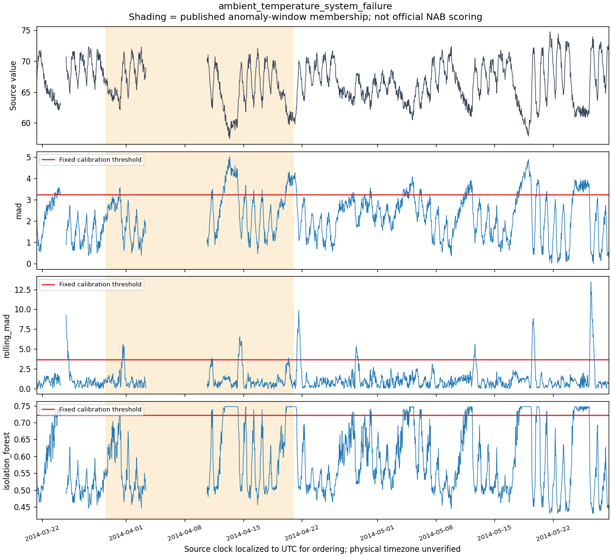
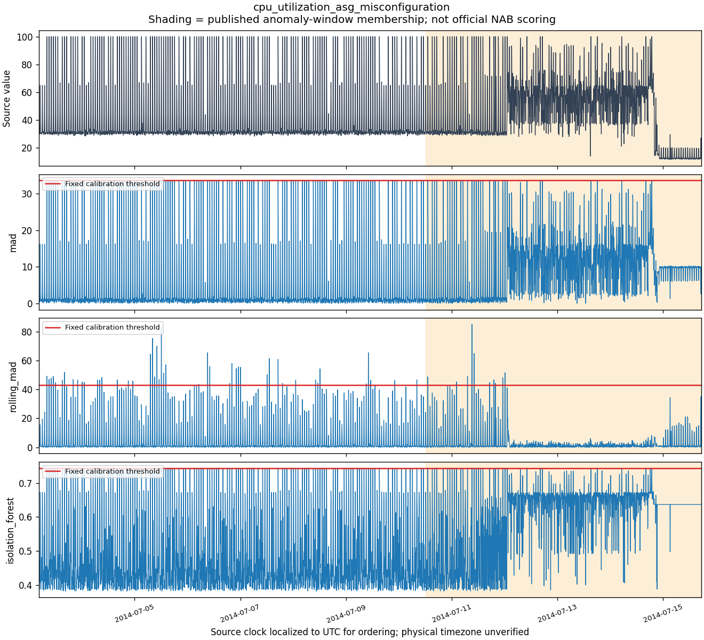

# First real-data evaluation — NAB local v1

Executed 2026-11-21, local CPU, Windows / Python 3.12.10. Three inputs preselected before CSV/model inspection: **two evaluated, one rejected by source validation**. This is a first real-data experiment, not validated industrial failure detection.

[Data/license card](nab_dataset_card.md), [fixed protocol and source-quality amendment](nab_protocol.md), [machine-readable results](nab-results.json), configs/nab_source_lock.json, third_party/NAB-NOTICE.md and original license.

## Source outcome

| Series | Source rows | Outcome |
|---|---:|---|
| machine_temperature_system_failure | 22,695 | Rejected: 12 conflicting timestamp groups; no correction or score |
| ambient_temperature_system_failure | 7,267 | Evaluated with fixed chronological periods |
| cpu_utilization_asg_misconfiguration | 18,050 | Evaluated with fixed chronological periods |

The initial command stopped at the invalid machine-temperature series before fitting any model. Raw inspection found conflicting values at 12 duplicate timestamps (2014-01-07 02:00 through 02:55). The documented amendment retains that rejected case and evaluates the two remaining preselected cases. It does not repair or replace the source. No performance-based exclusion.

## Split support and contamination diagnostics

| Series | Train rows / positives | Calibration rows / positives | Test rows / positives |
|---|---:|---:|---:|
| ambient_temperature_system_failure | 4360 / 363 | 1453 / 0 | 1454 / 363 |
| cpu_utilization_asg_misconfiguration | 10830 / 0 | 3610 / 0 | 3610 / 1499 |

Positive counts mean membership in the publisher anomaly intervals, not verified physical failures. No label-based normal filtering was used: ambient training contains 363 positive-window observations. All preprocessing/forest fits use training only. Distinct-timestamp 60/20/20 split per independent series; seed 42, 31-row rolling window and 2% calibration budget remain unchanged. No hyperparameter search, no reselection of dates, no test-label threshold optimization.

## Measured test results

| Series / method | Precision | Recall | F1 | AP | False alerts / 1,000 all observations |
|---|---:|---:|---:|---:|---:|
| ambient_temperature_system_failure / mad | 0.2988 | 0.2066 | 0.2443 | 0.3285 | 121.05 |
| ambient_temperature_system_failure / rolling_mad | 0.2658 | 0.0579 | 0.0950 | 0.2555 | 39.89 |
| ambient_temperature_system_failure / isolation_forest | 0.2988 | 0.2066 | 0.2443 | 0.3078 | 121.05 |
| cpu_utilization_asg_misconfiguration / mad | 0.0000 | 0.0000 | 0.0000 | 0.5802 | 0.00 |
| cpu_utilization_asg_misconfiguration / rolling_mad | 0.1864 | 0.0073 | 0.0141 | 0.3826 | 13.30 |
| cpu_utilization_asg_misconfiguration / isolation_forest | 1.0000 | 0.0007 | 0.0013 | 0.6128 | 0.00 |

Performance is weak. Ambient MAD/forest F1 is approximately 0.2443, with recall 0.2066 and substantial false alerts; rolling MAD F1 is approximately 0.0950. CPU frozen MAD detects none of 1,499 positive-window points, while forest detects only one; rolling MAD detects 11. A ranking AP around 0.58–0.61 on CPU does not imply useful recall at the fixed calibrated threshold. No post-hoc cutoff changes were made to improve this result.

JSON retains confusion counts, denominator flags, AP and trapezoidal PR separately, actual thresholds, exact partition membership hashes, boundary-clipped windows, raw event coverage/delay, source versions/hashes and independent unlabeled summaries. No aggregate leaderboard/ranking is generated for these heterogeneous series. Source labels are intervals; metrics classify interval membership and must not be described as official NAB scores or diagnostic accuracy. Alerts are never expanded to fill an interval.

Raw quality checks generated no review alerts in these two test series (no missing raw values; ambient has two gap resets). This does not mean the processes were healthy: the numeric anomaly target and raw quality rules address different questions. No separate quality ground truth or quality accuracy is asserted.

## Plots

Plots show source values, each model score and fixed thresholds; shaded regions are original published intervals. Clock timezone is an explicit unverified-coordinate assumption. Lines are broken around gaps greater than 1.5 times median observed cadence; no rows were resampled or changed in evaluation.





## Reproduction and executed checks

```powershell
# Explicit network step, pinned revision and frozen source hashes:
python scripts/download_nab.py
# The following evaluation is offline:
python scripts/evaluate_nab.py
python scripts/plot_nab.py
ruff check .
ruff format --check .
mypy src scripts app
pytest -q --junitxml=docs/nab-tests.xml
```

18 new offline tests pass. Full suite: **131 passed**, zero failures/errors/skips, 14 existing upstream Matplotlib/pyparsing deprecation warnings, 35.52 seconds. Ruff lint/format pass (37 Python files); strict Mypy passes (27 source files). New tests cover original tiny local fixtures, inclusive windows, invalid/missing labels, timezone assumptions, ordering/duplicate rejection with diagnostics, unsafe paths, source/revision/hash tampering, mutable-revision download rejection, full offline CLI evaluation including a rejected case, clipping at test boundaries, no official-score claim and unlabeled/quality output separation. No external dataset download occurs in tests or CI.

Failures encountered: GitHub DNS was blocked in the sandbox, so read-only revision lookup and explicit public download used approved escalation. Initially the license was looked up under LICENSE rather than LICENSE.txt; official repository navigation resolved the filename. A pandas Series generic annotation caused an import-time error in the first adapter tests; postponed annotations fixed it. Actual machine-source validation failed as described above; data was not silently repaired. Full app tests run with approved local socket access outside the sandbox. No dependency installation or detector parameter change.

## Limits and remaining work

- Publisher declares MIT for the pinned repository; original license/attribution retained. No separate per-file license or complete independent rights/provenance audit is invented. Raw data and label files remain ignored/local. No dataset or model was published.
- Publisher identifies these as real data, but source units, true timezone, annotation accuracy and causal event descriptions were not independently established. Some public label metadata was visible while researching suitability: not a blind trial.
- A convenience subset of two usable series, one rejected source, one fixed model seed and broad label windows is insufficient for generalization, confidence intervals, winner selection or deployment claims. Training contamination, regimes, cadence and unit-specific sensitivity can matter.
- Window membership is a different target from exact anomaly onset or physical fault diagnosis. Event windows may extend past test boundaries; the report discloses clipping. Tests already inspected here are development evidence for future changes.
- Machine-temperature evaluation remains blocked until a justified upstream/source-clock or duplicate-handling decision exists. Do not overwrite its original rows or invent offsets. A future documented protocol could evaluate a separately justified adaptation, but that would be a different experiment.
- The current models perform poorly on the accepted sources. Next model changes should be framed as development work, with a separately untouched evaluation, not retuning these test results and claiming an independent improvement. Quality flags must not be OR-combined with model predictions to inflate performance.
- Existing software limitations remain: trusted-only pickle artifacts, stateless full-batch replay, no heartbeat for absent records, limited quality-rule semantics, no hardened remote serving, no hosted CI run, no real-time SLA or production certification.

No paid API, cloud compute, GPU, purchase, publication, remote repository or external message was used. Downloaded seven public files totaling approximately 1.53 MB; fitting/scoring remained local and offline after download.
