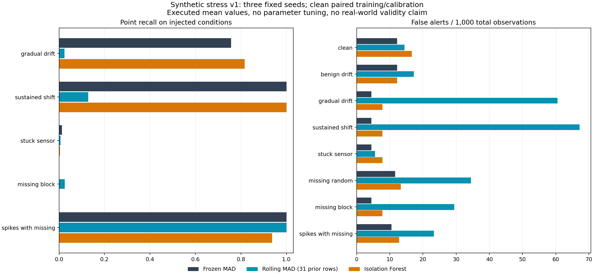

# Synthetic stress evaluation v1

Executed locally on 2026-11-21, Windows / Python 3.12.10. Original synthetic data only; no real-world diagnosis or fault-detection validity claim.

Protocol was written before execution: [plan](stress_protocol.md), configs/stress_protocol.json. Eight scenarios x three fixed seeds = 24 comparisons, three assets per comparison. Same clean training/calibration rows, fitted detector and thresholds reused within each seed. No parameter search or test-label tuning. All 24 scored CSVs are local ignored artifacts under artifacts/stress. Full committed machine-readable evidence: [stress-results.json](stress-results.json).

## Point recall on declared anomalous conditions

| Scenario | Frozen MAD | Rolling MAD | Isolation Forest |
|---|---:|---:|---:|
| gradual_drift | 75.65% | 2.41% | 81.57% |
| sustained_shift | 100.00% | 12.87% | 100.00% |
| stuck_sensor | 1.30% | 0.65% | 0.46% |
| missing_block | 0.00% | 2.50% | 0.00% |
| spikes_with_missing | 100.00% | 100.00% | 93.72% |

Values are equal-weight means across seeds, not pooled scores or a model ranking. JSON retains every seed, asset, confusion matrix, precision/F1/AP, event and missingness diagnostic. Controls without positive labels have no meaningful recall/F1 comparison: helper zero-division values remain explicitly flagged in raw JSON and are not included in this table or an overall ranking.

## False alerts per 1,000 total observations

| Scenario | Frozen MAD | Rolling MAD | Isolation Forest |
|---|---:|---:|---:|
| clean | 12.22 | 14.44 | 16.67 |
| benign_drift | 12.22 | 17.22 | 12.22 |
| gradual_drift | 4.44 | 60.56 | 7.78 |
| sustained_shift | 4.44 | 67.22 | 7.78 |
| stuck_sensor | 4.44 | 5.56 | 7.78 |
| missing_random | 11.67 | 34.44 | 13.33 |
| missing_block | 4.44 | 29.44 | 7.78 |
| spikes_with_missing | 10.56 | 23.33 | 12.78 |

Denominator is all 600 test observations per seed, including positives where present; it is not the negative-only false-positive rate. Clean, benign-drift and random-missing controls have no positive events. Both PR summaries are null in those single-class cases. False alerts after a perturbation ends count as false positives under the predeclared labels, including rolling-window recovery artifacts.

## Sustained event coverage: avoid misleading event-hit claims

| Scenario / method | First 31 event rows: mean point recall | Remaining 89: mean point recall |
|---|---:|---:|
| gradual_drift / mad | 17.56% | 95.88% |
| gradual_drift / rolling_mad | 2.87% | 2.25% |
| gradual_drift / isolation_forest | 30.11% | 99.50% |
| sustained_shift / mad | 100.00% | 100.00% |
| sustained_shift / rolling_mad | 46.24% | 1.25% |
| sustained_shift / isolation_forest | 100.00% | 100.00% |
| stuck_sensor / mad | 1.79% | 1.12% |
| stuck_sensor / rolling_mad | 1.08% | 0.50% |
| stuck_sensor / isolation_forest | 0.36% | 0.50% |
| missing_block / mad | 0.00% | 0.00% |
| missing_block / rolling_mad | 9.68% | 0.00% |
| missing_block / isolation_forest | 0.00% | 0.00% |

Each event lasts 120 rows at default size. Event diagnostics separately export first-alert delay (zero-based observation count), misses as null delay, and raw point coverage. An event hit does not expand a single alert across its whole interval and never replaces raw point recall.

## Observed weaknesses

- Rolling adaptation erases long changes: sustained-shift recall is about 12.87% overall, with only about 1.25% coverage after the first 31 rows. Returning to nominal behavior also produces recovery false alerts. Gradual-drift recall is about 2.41%, despite much higher frozen/forest recall on this specified signal.
- All three methods almost miss a sensor stuck at a plausible value. The untouched vibration sensor can produce occasional incidental alerts; an event hit does not establish detection of the stuck mechanism.
- Median imputation hides a simultaneous two-sensor outage: frozen MAD and forest recall are exactly zero for missing_block in these runs. Rolling MAD catches a few initial deviations but has zero late coverage. None is a dedicated missingness detector.
- Benign drift/random missingness can still trigger alerts. Random missingness roughly doubles rolling false alerts versus the clean control (34.44 versus 14.44 per 1,000). Do not interpret an imputed numeric score as a reliable data-quality monitor.
- Strong point spikes remain comparatively easy here, even with 10% per-sensor missingness; this does not demonstrate robustness to all-hidden spikes, subtler spikes, correlated outages or real sensor faults.

## Interpretation, limitations and next experiment

The benchmark label policy is explicit: nuisance random missingness and small drift are normal controls, while a plausible stuck value or total outage is labeled an anomalous injected condition. These are designed test expectations, not physical diagnoses. Gradual drift labels include the exactly nominal first ramp point and near-unobservable onset, making early detection intrinsically difficult. Abrupt event recovery is part of this finite-interval protocol.

The nominal generator has a predictable sinusoid and independent Gaussian noise. Asset distributions are homogeneous; clocks, real process dynamics, delays, physical operating limits, intermittent freezes, multivariate faults, overlapping interventions and sustained drift beyond this finite interval remain untested. Window duration is observation-count based. Only three seeds were used; no confidence interval, significance claim, severity sweep or hyperparameter comparison is justified. Population standard deviations are available in JSON, not confidence bounds.

This suite uses clean fit periods, unlike the older contaminated-spike benchmark. Thresholds therefore differ; compare methods within this paired suite rather than claiming improvement over earlier F1 values. Detector algorithms, window and alert budgets were not changed after results were inspected. Sources, canonical protocol/dataset hashes, versions, exact split memberships and unchanged thresholds are retained in the JSON. Unlabeled views omit supervised quality metrics.

A justified next experiment would add explicit data-quality checks (missingness and stuck/low-variance signals), then evaluate them on a separately frozen protocol and new untouched seeds. Revising these methods and presenting this same inspected suite as an untouched final test would be invalid. No such detector change or external-dataset work was included in this step.

## Reproduction and validation

```powershell
python scripts/stress_benchmark.py --export-csv
python scripts/plot_stress.py
ruff check .
ruff format --check .
mypy src scripts app
pytest -q --junitxml=docs/stress-tests.xml
```

Targeted stress tests: 25 passed. Full suite: **88 passed**, zero failures/errors/skips, 14 existing upstream Matplotlib/pyparsing deprecation warnings; 37.21 seconds. Ruff lint/format pass (27 Python files); strict Mypy passes (19 source files). JUnit: stress-tests.xml. Tests verify paired unmodified fit periods, deterministic generation, exact injection/label boundaries, missing-mask pairing, retained hidden labels, no current/future/history mutation, no event point adjustment, CSV/JSON roundtrip, unlabeled output fields and invalid-protocol rejection. The full Gradio suite ran outside the sandbox because its local socket setup is blocked inside it, as previously diagnosed. No new package installation, dependency change, paid API, publication or model-parameter optimization occurred.

The comparison chart was rendered from the measured JSON and visually inspected; it is not a live inference UI or a claimed industrial result.


